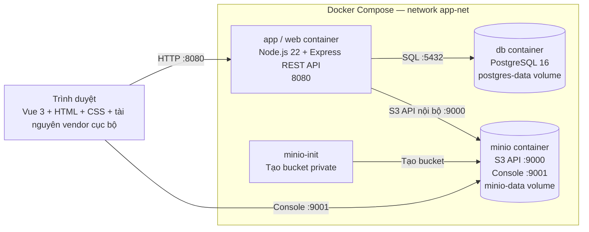

# Deployment Diagram

Compose publish app `8080:8080`, MinIO S3 `9000:9000` và Console `9001:9001`. PostgreSQL chỉ nằm trong network riêng. Credential được nạp qua `.env`; hai named volume giữ dữ liệu khi container bị dừng/xóa mà không dùng `-v`. Bucket MinIO private; giao diện nhận URL nội bộ có JWT dùng riêng cho một tệp, hết hạn sau 10 phút.
