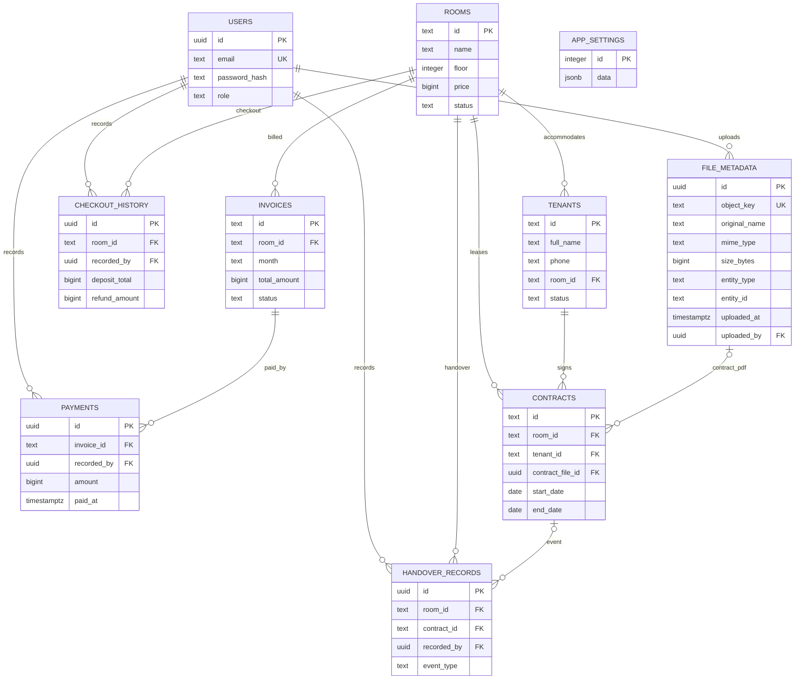

# ERD — đọc từ `api/migrations/001_initial.sql`

`file_metadata.entity_id` là khóa ngoại đa hình: loại thực thể nằm ở `entity_type`; migration không đặt một FK đơn tới nhiều bảng. `contracts.contract_file_id` tham chiếu `file_metadata.id`. Nội dung tệp nằm trong MinIO; PostgreSQL lưu metadata và object key.
